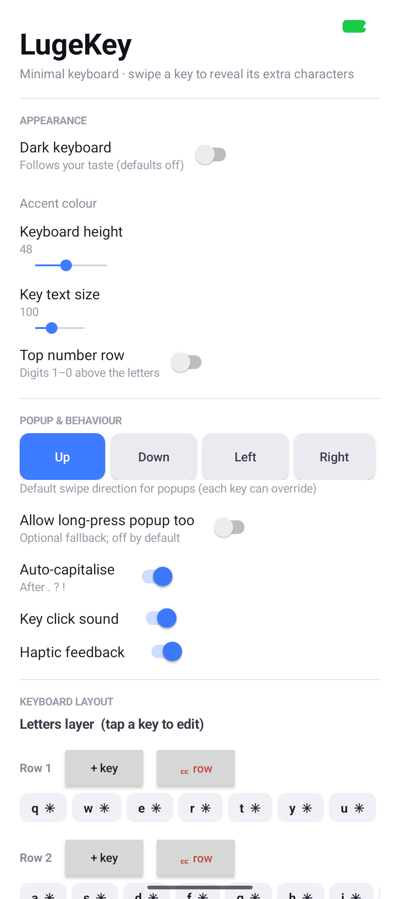
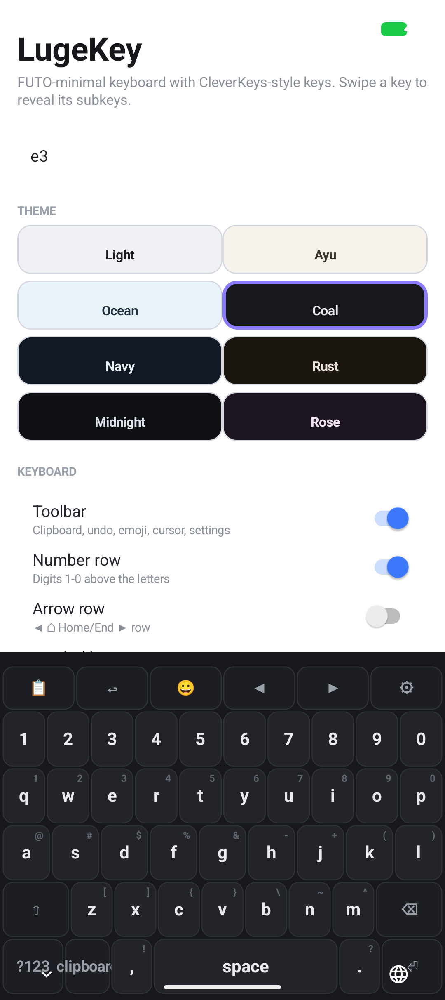

# LugeKey — a minimal, fully customizable Android keyboard

A blend of two ideas, taken from the real apps:

- **FUTO Keyboard** styling — flat, compact, clean, modern, curated themes.
- **CleverKeys** per-key customization — every key is editable, each with its own
  sub-keys, custom output text/macros, and commands.

And the headline interaction we changed on purpose:

> **Swipe a key** (default: swipe **up**) and its **subkeys pop open instantly**
> in a radial popover — like CleverKeys' subkey popover but triggered by a
> swipe instead of a long-press. No long-press required.

## What it does

- Full Android **IME** — enable it in *Settings → System → Languages & input →
  Keyboards*.
- **8 curated FUTO-style themes** (Light, Ayu, Ocean, Coal, Navy, Rust,
  Midnight, Rose), switchable from settings.
- **Radial subkey popover**: swipe up on `a` → its subkeys (`@ á à â ä…`)
  burst open around the key; slide to one and release to type it. Cancel by
  releasing in the middle. Swipe direction is configurable per key and globally;
  an optional long-press fallback is available (off by default).
- **Per-key customization** (CleverKeys-style): any key can be relabeled,
  retargeted, given its own subkeys (characters, words or emoji), or turned
  into a command: Shift, Space, Enter, Tab, **Delete word**, **Undo**,
  Cursor left/right, **Home/End**, Switch IME, Symbols page, **Emoji page**,
  **Clipboard**, or Open settings. Custom text macros up to ~millions of chars.
- **Layout editor** in settings: add/remove rows and keys on both the letters
  and symbols layers.
- **Toolbar** (optional): clipboard, undo, emoji, cursor, settings at the top.
- **Number row** and **arrow row** toggles, **symbol hints** on letter keys.
- **Clipboard history** with a panel on the keyboard: recent items are recorded
  from system copies and (optionally) long words you type; tap to paste,
  clear from settings.
- **Undo**, **delete word**, hold-⌫ to repeat, swipe-left on ⌫ to delete a word.
- Keyboard height/text-size sliders, key click sound, haptics, auto-capitalise.

## Build (no Gradle — just the plain SDK tools)

The project builds directly with the Android SDK command-line tools
(`aapt2` → `javac` → `d8` → `zipalign` → `apksigner`). No wrapper, no
dependency downloads. Prereqs: Android SDK platforms 35 + build-tools 35.0.0.

```powershell
.\tools\build.ps1
# output: LugeKey-0.2.2.apk  (signed with tools/debug.keystore, runs on any ABI incl. aarch64)
```

`minSdk 26` (Android 8.0+), `targetSdk 35`.

## Screenshots




## Project layout

```
src/net/carbonwalls/lugekey/
  LugeIME.java         InputMethodService — commit, undo, clipboard capture, cursor/word actions
  KeyboardView.java    rendering, themes, pages, gestures + the radial subkey popover
  KeyDef.java          the editable key model (kind, label, output, subkeys)
  LayoutStore.java     default layers (letters/symbols/emoji) + JSON persistence
  ClipboardHistory.java  small persistent clipboard history store
  Theme.java           the curated palette registry
  Prefs.java           settings + layouts
  Fx.java              click sound + haptics
  SettingsActivity.java  settings: themes, toggles, clipboard manager, layout editor
tools/build.ps1        offline build script
```

## Notes

- The APK has no native code, so it runs on every ABI, including `arm64-v8a`.
- The debug signing key is generated on first build and committed so re-installs
  keep the same signature.
